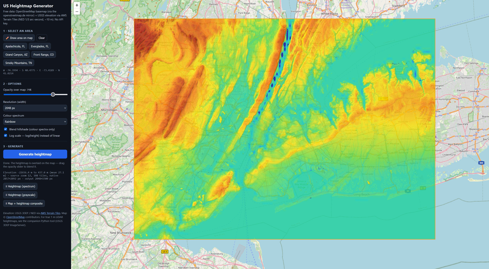

# US Heightmap Generator (TypeScript)



A browser app that:

1. Shows a **US map** (Leaflet) with the standard **OpenStreetMap** style served by the free **tile.openstreetmap.de** mirror, with an automatic Esri World Street Map fallback. Direct tile.openstreetmap.org tiles are unusable from apps: the server answers with an HTTP-200 placeholder PNG reading "Access blocked / App is not following the tile usage policy" (verified from the tile bytes). CARTO basemaps are not an alternative either — keyless requests return an "API KEY REQUIRED" placeholder tile (also byte-verified).
2. Lets you **select an area** — drag a rectangle on the map, or use a preset.
3. Lets you set **opacity**, **resolution** (512–4096 px wide), and the
   **colour spectrum** (Terrain, Grayscale, Viridis, Inferno, Rainbow,
   with optional hillshade blending for the colour spectra).
4. On **Generate**, pulls elevation data and renders the heightmap,
   overlaid on the map at the chosen opacity.
5. Downloads: spectrum heightmap PNG, pure grayscale heightmap PNG
   (linear, game-engine ready), and a **composite** PNG — OSM basemap +
   heightmap blended at exactly the chosen opacity.

## Data source

**AWS Terrain Tiles** (Registry of Open Data on AWS) — Terrarium-encoded
PNG tiles, free, no API key, CORS-enabled:

```
https://s3.amazonaws.com/elevation-tiles-prod/terrarium/{z}/{x}/{y}.png
elevation_m = R*256 + G + B/256 - 32768
```

Over the continental US the tiles are sourced from **USGS NED
1/3 arc-second (~10 m)**, the seamless layer of the USGS 3D Elevation
Program (3DEP) — the same free dataset as the companion Python tool
(`~/workspace/florida-heightmap/`), which remains the route for true
**1 m LiDAR** heightmaps (the web tiles top out at ~10 m source data;
the app caps tile zoom at 14 for that reason).

## Run it

```bash
npm install
npm run dev      # http://localhost:5173
npm run build    # type-check + production build into dist/
npm run preview  # serve the production build
```

## Layout

- `src/main.ts` — Leaflet map, rectangle area selection, UI wiring
- `src/terrain.ts` — tile math, Terrarium fetch/decode, zoom selection
- `src/render.ts` — resampling, spectrum rendering, hillshade, OSM composite export
- `src/ramps.ts` — colour spectra definitions

Attribution: map © OpenStreetMap contributors; elevation data USGS /
AWS Terrain Tiles (public domain / open data).
